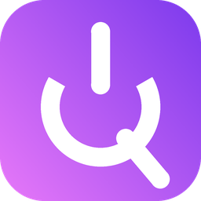

# Qwen Studio

**Your own private AI chat — Qwen 3.8 (27B) running free on Kaggle's GPUs.**
No subscription. No API key to buy. It runs in *your* Kaggle account.

---

> [!WARNING]
> **Before you install, you need a free Kaggle account with a verified phone number.**
> 1. Create an account: **[kaggle.com → Register](https://www.kaggle.com/account/login?phase=startRegisterTab)**
> 2. Verify your phone: **[kaggle.com/settings](https://www.kaggle.com/settings)** → *Phone verification*
>
> Kaggle only gives free GPUs to phone-verified accounts. Without this, the app cannot start.

## ⬇ Download

Windows 10 or 11. Nothing else to install.

## Setup — about 2 minutes, once

1. **Run `Qwen-Studio-Setup.exe`.** If Windows says *"Windows protected your PC"*, click **More info → Run anyway** (the app is new and not code-signed yet).
2. **Open Qwen Studio** from your desktop. It shows the Kaggle warning above — click **I have a verified Kaggle account**.
3. Click **Sign in with Kaggle**. Your browser opens Kaggle: sign in if asked, then click **Allow**.
4. Back in the app: **press the big switch**. The first start takes about 6 minutes while Kaggle downloads the model. Then just chat.

That's it. No passwords to copy, no keys to paste.

## How it works

- Pressing the switch starts a private notebook called `qwen-studio-server` in **your** Kaggle account, on Kaggle's free 2× T4 GPUs (about 30 free GPU hours per week).
- The server is protected by a random key created on your PC during setup. Only your app has it.
- Turning the switch off stops the Kaggle session, so your free hours aren't wasted. If you forget, it stops by itself.
- Replies start in about 1–2 seconds and stream at roughly 10 words per second.

## Problems?

| What you see | What to do |
|---|---|
| "Windows protected your PC" | **More info → Run anyway** |
| Sign-in never finishes | Make sure you clicked **Allow** on the Kaggle page, then press **Sign in with Kaggle** again |
| Stuck on "Queued for a GPU" | Kaggle's free GPUs are busy. Leave it — it starts when one is free |
| Server never starts | Check your phone is verified on [kaggle.com/settings](https://www.kaggle.com/settings), and that you have GPU hours left this week |

## For developers

- `desktop/qwen_shell.py` — the Windows app (pywebview + WebView2); `desktop/shell.html` its UI.
- `desktop/kaggle_ctl.py` — Kaggle API: sign-in (OAuth), push, status, stop, GPU quota.
- `gateway/` — the server side: `kernel_template.py` (Ollama + Qwen + cloudflared tunnel) and `gateway.py` (key-protected, OpenAI-compatible API). The app builds the notebook from these on every start.
- `app/chat.html` — the chat UI.
- `installer/QwenStudio.iss` — Inno Setup script. Build the app with PyInstaller first:
  `pyinstaller --windowed --name "Qwen Studio" --icon desktop\qwen.ico --distpath desktop\dist-installer --collect-all webview --collect-all kagglesdk --collect-all kaggle --collect-all pystray --hidden-import kaggle_ctl desktop\qwen_shell.py`
